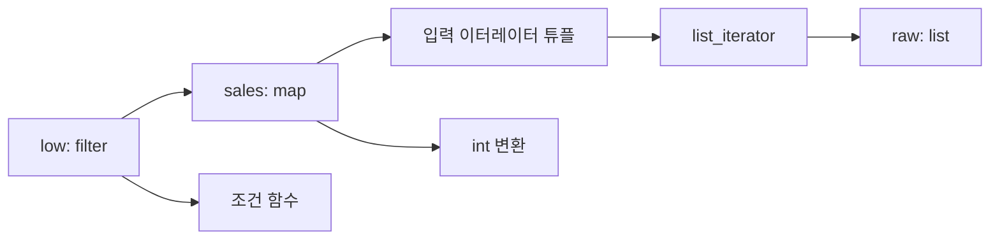

# 002. Python 이터레이터의 소비와 참조를 C로 따라가기

**학습일** 2026-11-06 · **환경** Jupyter Notebook / CPython, Linux VS Code / GCC

## 1. 왜 `sales`가 빈 리스트가 될까?

질문에 적은 원본이다. 마지막 줄의 여분 괄호를 지운 뒤 실행한다.

```python
raw = ["1200", "850", "1530", "720"]

sales = map(int, raw)
low = list(filter(lambda n: n < 1000, sales))

print(list(sales))
print(low))
```

```python
print(low)
```

수정한 셀의 출력은 첫 줄이 `[]`, 다음 줄이 `[850, 720]`이다. `list(filter(...))`가 조건을 만족하는 결과를 모으기 위해 입력을 끝까지 읽는다. 이때 조건에서 탈락한 1200과 1530도 이미 읽었다. 따라서 이후 `list(sales)`에는 남은 값이 없다. Notebook에서 다시 실험할 때는 `sales = map(int, raw)`부터 재실행한다.

## 2. Iterable, Iterator, 지연 평가

아래 Python 코드는 제공한 예제를 그대로 옮겼다. 각 실험은 독립된 셀에서 실행한다. 일부 짧은 예제는 바로 앞 셀에서 만든 변수를 이어 쓴다.

```python
raw = ["1200", "850", "1530", "720"]

iterator = iter(raw)
```

리스트는 순회할 때마다 새 이터레이터를 얻을 수 있다. 이터레이터는 `__iter__()`로 자신을 반환하고, `__next__()`로 다음 값을 제공한다. 마지막 값 이후에는 `StopIteration`이 발생한다.

```python
numbers = iter([10, 20, 30])

print(next(numbers))  # 10
print(next(numbers))  # 20
print(next(numbers))  # 30
```

`map`과 `filter`는 다음 값이 요청될 때 변환이나 조건 검사를 수행한다.

```python
raw = ["1200", "850", "1530", "720"]

sales = map(int, raw)
```

```python
print(next(sales))  # 1200
print(next(sales))  # 850
print(list(sales))  # [1530, 720]
print(list(sales))  # []
```

```python
raw = ["1200", "850", "1530", "720"]

sales = map(int, raw)
low = filter(lambda n: n < 1000, sales)
```

```python
print(list(low))
# [850, 720]

print(list(sales))
# []
```

## 3. 주소와 참조를 구분하기

```python
raw = ["1200", "850", "1530", "720"]
sales = map(int, raw)
low = filter(lambda n: n < 1000, sales)

print(sales)
print(low)
```

CPython의 기본 객체 표현에서 `at 0x...`는 객체의 **프로세스 가상 주소**를 16진수로 나타낸다. `id()`는 객체가 살아 있는 동안 일정한 식별값이며, CPython에서는 객체 주소를 사용한다. 서로 다른 시점에 생성된 객체가 같은 주소를 재사용할 수 있다.



이 그림은 소진 전 CPython의 참조 구조를 나타낸다. `low`가 다음 값을 찾을 때 `sales`를 전진시키고, `sales`는 리스트 이터레이터를 전진시킨다. 정수 변환 결과 중 통과한 값의 참조를 결과 리스트에 담는다. 원본 리스트의 문자열들은 그대로 남는다.

## 4. Python 관찰 실험

### 실험 1. 식별값과 객체 자체의 크기

```python
import sys

raw = ["1200", "850", "1530", "720"]
sales = map(int, raw)
low = filter(lambda n: n < 1000, sales)

for name, obj in [
    ("raw", raw),
    ("sales", sales),
    ("low", low)
]:
    print(f"{name}:")
    print(f"  ID: {id(obj)}")
    print(f"  HEX: {hex(id(obj))}")
    print(f"  SIZE: {sys.getsizeof(obj)} bytes")
```

`getsizeof()`는 객체에 직접 귀속된 크기를 보여준다. 입력 데이터나 변환 함수 등 참조 대상의 크기는 합산하지 않는다. 주소와 크기는 실행 환경에 따라 달라진다.

### 실험 2. 살아 있는 객체의 주소로 참조 확인

```python
import ctypes

raw = ["1200", "850", "1530", "720"]

address = id(raw)

recovered = ctypes.cast(
    address,
    ctypes.py_object
).value

print("Original:", raw)
print("Recovered:", recovered)
print("Same object:", recovered is raw)
```

`Same object: True`를 확인한다. CPython에서 `raw`가 살아 있는 동안 얻은 주소만 사용한다. 임의 주소나 수명이 끝난 객체의 주소를 역참조하면 커널이 충돌할 수 있다.

### 실험 3. 소비 전후 식별값 비교

```python
raw = ["1200", "850", "1530", "720"]
sales = map(int, raw)

initial_id = id(sales)

print("First:", next(sales))
print("Second:", next(sales))

print("Remaining:", list(sales))
print("After exhausted:", list(sales))

print("ID unchanged:", id(sales) == initial_id)
print("Original:", raw)
```

처음 두 값은 1200과 850, 남은 값은 `[1530, 720]`이다. 소진 뒤에는 `[]`이며 식별값은 그대로이고 원본 문자열도 남는다.

### 실험 4. 두 경로로 같은 입력 이터레이터 소비

```python
raw = ["1200", "850", "1530", "720"]

sales = map(int, raw)
low = filter(lambda n: n < 1000, sales)

print(next(low))
print(list(sales))
print(list(low))
```

출력은 `850`, `[1530, 720]`, `[]` 순서다. 첫 요청에서 1200과 850을 읽는다. 이후 `sales`에서 나머지를 읽었으므로 `low`에서도 반환할 값이 없다.

### 실험 5. GC가 탐색하는 참조 확인

```python
import gc

raw = ["1200", "850", "1530", "720"]

sales = map(int, raw)
low = filter(lambda n: n < 1000, sales)

print("low references sales:",
      any(ref is sales for ref in gc.get_referents(low)))

print("sales references:")
for ref in gc.get_referents(sales):
    print(type(ref).__name__, hex(id(ref)))
```

첫 확인은 `True`다. `sales`의 직접 참조에는 입력 이터레이터를 담는 튜플과 변환 함수 `int`가 나타날 수 있다. `gc.get_referents()`의 관찰 범위는 GC 탐색 훅이 방문하는 참조다.

### 실험 6. 리스트 이터레이터의 인덱스 확인

```python
raw = ["1200", "850", "1530", "720"]

iterator = iter(raw)

print("Initial:", iterator.__reduce__())

next(iterator)
print("After 1:", iterator.__reduce__())

next(iterator)
print("After 2:", iterator.__reduce__())

next(iterator)
print("After 3:", iterator.__reduce__())
```

CPython에서 이 예제의 반환 튜플 **세 번째 원소**에 인덱스 0, 1, 2, 3이 순서대로 나타난다. 구조는 대략 `(iter, (raw,), index)`다. 이는 리스트 이터레이터의 직렬화용 표현이다.

## 5. 같은 결과를 다시 사용하려면

### 리스트로 구체화

```python
raw = ["1200", "850", "1530", "720"]

sales = list(map(int, raw))
low = list(filter(lambda n: n < 1000, sales))

print(sales)
print(low)
```

### tee로 순회 분리

```python
from itertools import tee

raw = ["1200", "850", "1530", "720"]

sales = map(int, raw)

sales_a, sales_b = tee(sales, 2)

low = list(filter(lambda n: n < 1000, sales_a))
all_sales = list(sales_b)

print(all_sales)
print(low)
```

두 예제 모두 `[1200, 850, 1530, 720]`와 `[850, 720]`을 출력한다. 리스트는 요소의 참조를 보관하므로 재순회할 수 있다. `tee`는 입력을 한 번 읽으면서 각 분기의 진행 차이를 버퍼링한다. 한쪽이 먼저 끝까지 읽으면 다른 쪽이 읽을 값 전체가 버퍼에 남을 수 있다.

## 6. C로 옮기기

Python은 `next()`와 `StopIteration`으로 순회를 표현한다. 이 실습의 C 코드는 `bool` 반환값과 출력 포인터 `out`으로 다음 값의 존재를 전달한다. CPython의 내부 배치를 모사하는 대신 입력 참조와 인덱스를 눈으로 확인할 수 있게 구성했다. 입력은 예제의 정상적인 정수 문자열로 한정한다.

| Python | C 실습에서 대응하는 부분 |
|---|---|
| 리스트 이터레이터의 위치 | `MapIter.index` |
| `map(int, raw)` | `MapIter`와 `map_next()` |
| `filter(lambda n: n < 1000, sales)` | `FilterIter`와 조건 함수 포인터 |
| 두 경로에서 공유하는 `sales` | `FilterIter.source = &sales` |
| `list(iterator)` | 반복해서 다음 값을 읽는 루프 |

### 먼저 작성해 볼 순서

1. `MapIter`에 입력 배열, 길이, 다음 인덱스를 넣는다.
2. `map_next`에서 끝이면 `false`를 반환한다. 값이 있으면 문자열을 정수로 바꾸고 인덱스를 1 올린다.
3. `filter_next`는 조건을 통과할 때까지 같은 `MapIter`에서 읽는다.
4. `filter_next`를 한 번 부른 뒤 `sales.index`를 예상한다. 850을 돌려주려면 1200도 읽어야 하므로 2다.
5. `MapIter copy = sales;`를 만들어 복사본의 인덱스만 움직여 본다. `&sales`를 공유할 때와 달리 구조체 복사는 인덱스를 별도로 가진다.

### 실행 예제

아래 코드를 `iterator_demo.c`에 저장한다. `strtol`은 문자열을 정수로 바꾸며, 여기서는 배열에 적힌 네 입력이 모두 `int` 범위에 있다고 가정한다.

```c
#include <stdbool.h>
#include <stddef.h>
#include <stdio.h>
#include <stdlib.h>

typedef struct {
    const char *const *items;
    size_t length;
    size_t index;
} MapIter;

typedef struct {
    MapIter *source;
    bool (*predicate)(int);
} FilterIter;

bool map_next(MapIter *iter, int *out)
{
    if (iter->index >= iter->length) {
        return false;
    }

    *out = (int)strtol(iter->items[iter->index], NULL, 10);
    iter->index++;
    return true;
}

bool below_1000(int value)
{
    return value < 1000;
}

bool filter_next(FilterIter *iter, int *out)
{
    while (map_next(iter->source, out)) {
        if (iter->predicate(*out)) {
            return true;
        }
    }
    return false;
}

int main(void)
{
    const char *const raw[] = {"1200", "850", "1530", "720"};
    MapIter sales = {raw, sizeof raw / sizeof raw[0], 0};
    FilterIter low = {&sales, below_1000};
    int value;

    printf("&sales=%p, low.source=%p\n", (void *)&sales, (void *)low.source);
    printf("index before: %zu\n", sales.index);

    if (filter_next(&low, &value)) {
        printf("first low: %d\n", value);
    }
    printf("index after filter: %zu\n", sales.index);

    printf("remaining sales:");
    while (map_next(&sales, &value)) {
        printf(" %d", value);
    }
    putchar('\n');

    printf("low has more: %s\n", filter_next(&low, &value) ? "true" : "false");
    printf("final index: %zu, raw[0]: %s\n", sales.index, raw[0]);
    return 0;
}
```

두 주소는 같은 실행에서 일치한다. 주소 줄 아래의 출력은 다음과 같다.

```text
index before: 0
first low: 850
index after filter: 2
remaining sales: 1530 720
low has more: false
final index: 4, raw[0]: 1200
```

## 7. Linux VS Code에서 빌드하고 실행하기

VS Code에서 저장소 폴더를 열고, 통합 터미널에서 `gcc --version`을 실행한다. GCC가 없다면 Ubuntu/Debian 기준으로 `sudo apt install build-essential`을 실행한다. 다른 배포판에서는 해당 배포판의 패키지 관리자를 사용한다.

저장소 최상위 폴더에서 다음을 실행한다.

```bash
mkdir -p c/002-iterator/build
gcc -std=c11 -Wall -Wextra -Wpedantic -g c/002-iterator/iterator_demo.c -o c/002-iterator/build/iterator_demo
./c/002-iterator/build/iterator_demo
```

빌드 결과는 `build/`에 저장된다. `build/.gitignore`를 추적하여 폴더 구조를 유지하고, 실행 파일은 로컬에 보관한다.

## 8. 다음 실습

`filter_next`를 한 번만 부르는 부분을 `while (filter_next(&low, &value))`로 바꿔 본다. 그 뒤 `map_next(&sales, &value)`가 바로 `false`를 반환하는지 확인하면, 처음 Python 질문의 `list(filter(...))` 동작을 C에서 재현할 수 있다.

참고자료. [Python 내장 함수](https://docs.python.org/3/library/functions.html) · [이터레이터 타입](https://docs.python.org/3/library/stdtypes.html#iterator-types) · [itertools.tee](https://docs.python.org/3/library/itertools.html#itertools.tee) · [CPython 내장 함수 구현](https://github.com/python/cpython/blob/3.13/Python/bltinmodule.c)
